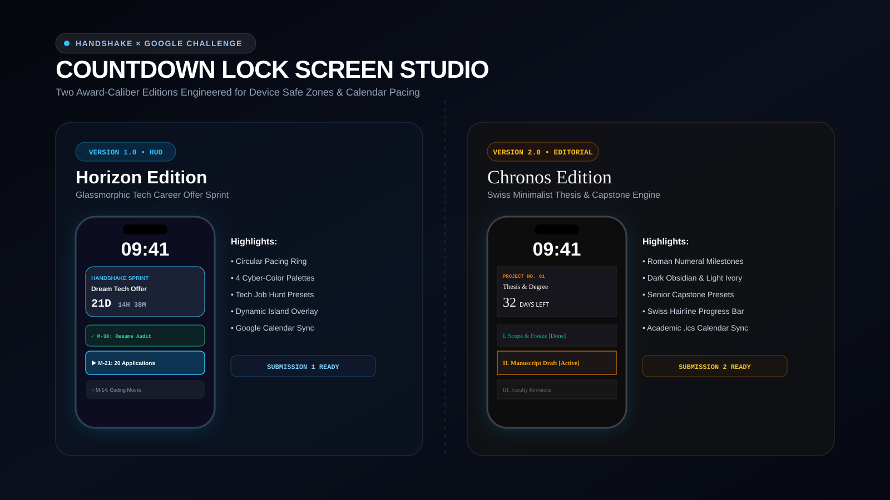

# 📱 Countdown Lock Screen Studio

> **Built for the Handshake AI Skills Studio × Google Challenge**  
> *"Your Deadline, Your Design: Create a Countdown Lock Screen with Google"*

---

## What is this project?

**Countdown Lock Screen Studio** is a free web tool that helps you create custom wallpaper pictures for your phone and computer. 

Instead of just showing days counting down (which can feel stressful!), it breaks your big goal down into **5 simple, step-by-step milestones**. Every time you check your phone, you see the exact milestone you should focus on right now.

---

## Why did we build it?

We all have big deadlines—like getting a dream job offer, finishing a final project, or graduating college. 

When you only see a timer running down, it's easy to feel overwhelmed. But when you work backward and know:
1. What to do this week
2. What to do next week
3. And what to do right before the finish line

...big goals become easy and exciting to achieve!

---

## ✨ 2 Beautiful Styles Included

You can switch between two different looks with just one click at the top:

### 1. 🌌 Horizon Edition (Modern & Tech-Inspired)
* Dark, glowing futuristic look.
* Great for: **Landing your first tech job**, internships, or building an app.
* Has a circular progress ring and colorful themes (cyan, amber, green, purple).

### 2. 📜 Chronos Edition (Clean & Minimalist)
* Looks like a classic magazine or notebook page.
* Great for: **Final exams**, college thesis, capstone projects, and graduation.
* Uses Roman numerals (`I`, `II`, `III`, `IV`, `V`) and comes in Dark Slate or Light Paper styles.

---

## 💡 Key Features (Made Simple)

* **Leaves space for your phone's clock:** The wallpaper is designed so your phone's time, date, and notifications stay 100% clear and easy to read.
* **Live ticking timer:** Watch the days, hours, and minutes tick down in real time.
* **Works on phone & computer:** Pre-sized for iPhones, Android phones, MacBooks, and PCs.
* **1-Click Google Calendar reminders:** Download a `.ics` file that automatically adds milestone reminders to your Google or Apple Calendar.
* **No sign-up or install needed:** Runs completely inside your web browser.

---

## 🚀 How to Open and Use It

You do not need to install anything!

1. Open the `countdown-lock-screen` folder.
2. Double-click **`index.html`** to open it in Chrome, Safari, or Edge.
3. Pick your favorite style (**Horizon** or **Chronos**).
4. Type in your goal and deadline date.
5. Click **"Download Lock Screen Wallpaper"** to save your new wallpaper picture!

---

## 📲 How to Set It as Your Phone's Lock Screen

### On iPhone:
1. Send the saved wallpaper to your phone (AirDrop, email, or save image).
2. Open **Settings** > **Wallpaper** > **Add New Wallpaper** (or tap and hold your lock screen).
3. Pick your downloaded wallpaper from your Photos.
4. Tap **Done**!

### On Android:
1. Save the wallpaper image to your phone's Gallery.
2. Tap and hold your home screen > tap **Wallpaper & Style**.
3. Select **Change Wallpaper** > choose your image > tap **Set on Lock Screen**.

---

## 🏆 For Contest Submission

If you are entering the **Handshake AI Skills Studio Challenge**:
* Check [`SUBMISSION.md`](SUBMISSION.md) inside this folder for copy-paste project details.
* Upload [`assets/cover_showcase.svg`](assets/cover_showcase.svg) as your project cover image.
* Contest deadline: **November 23, 2026**.
